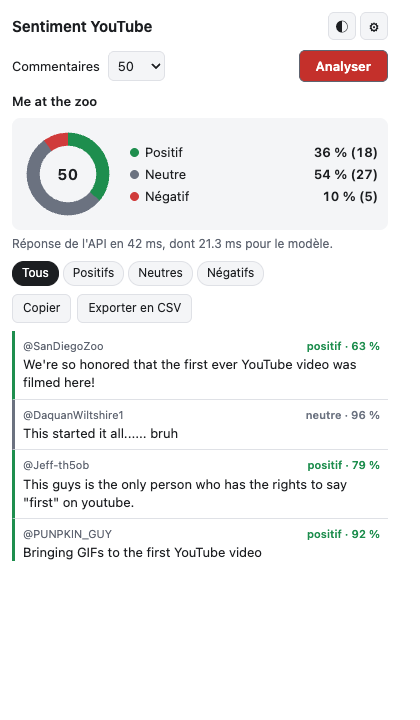

# Analyse de sentiment des commentaires YouTube

Système MLOps complet : une extension Chrome extrait les commentaires d'une vidéo YouTube, une API FastAPI les classe en **positif**, **neutre** ou **négatif**, et l'extension affiche les résultats.

TP3 Cloud Computing, filière INDIA, ENSAM Rabat, 2026/27.



**API déployée :** `À COMPLÉTER après le déploiement`

## Architecture

```text
Page YouTube                Extension Chrome                 API FastAPI (Docker, Hugging Face)
+-----------+  content.js  +----------------+  POST batch   +----------------------------------+
| commentaires | -------> | popup.js        | ------------> | nettoyage -> TF-IDF -> régression |
+-----------+              | stats, filtres |  <----------- | logistique                       |
                           +----------------+   prédictions +----------------------------------+
```

| Composant | Technologie |
|---|---|
| Frontend | Extension Chrome Manifest V3 (JavaScript, HTML, CSS) |
| Backend | FastAPI, Pydantic, Uvicorn |
| Modèle | scikit-learn : TF-IDF + régression logistique |
| Déploiement | Hugging Face Spaces (Docker) |

## Résultats

Mesurés sur un test set de 7 290 commentaires jamais vus à l'entraînement (`reports/metrics.json`).

| Critère du TP | Objectif | Résultat |
|---|---|---|
| Accuracy | ≥ 80 % | **89,6 %** |
| F1 négatif | > 0,75 | **0,82** |
| F1 neutre | > 0,75 | **0,94** |
| F1 positif | > 0,75 | **0,90** |
| Inférence sur 50 commentaires (p95) | < 100 ms | **1,3 ms** |

**Limites :** le modèle a été entraîné sur Reddit, pas sur YouTube, ces scores ne valent donc pas directement pour YouTube. Il gère mal la négation (« not good » sort positif), sa confiance affichée est souvent trop élevée, et il n'analyse que l'anglais. Voir `docs/RAPPORT.md`.

## Installation

Python 3.10 ou supérieur est requis ; le projet a été testé en 3.10, comme l'image Docker.

```bash
python3.10 -m venv .venv
source .venv/bin/activate
pip install -r requirements.txt
```

## Reproduire le modèle

```bash
python -m src.data.download
python -m src.data.prepare
python -m src.data.eda
python -m src.models.train
python -m src.models.evaluate
```

## Lancer l'API

```bash
uvicorn app_api:app --port 7860
```

Documentation interactive : <http://localhost:7860/docs>. Référence : [docs/API.md](docs/API.md).

## Installer l'extension

1. Ouvrir `chrome://extensions` et activer le **mode développeur**.
2. Cliquer sur **Charger l'extension non empaquetée** et choisir le dossier `chrome-extension/`.
3. Ouvrir une vidéo YouTube, cliquer sur l'icône de l'extension, puis sur **Analyser**.

Guide complet : [docs/GUIDE_EXTENSION.md](docs/GUIDE_EXTENSION.md).

## Déployer sur Hugging Face

```bash
source .venv/bin/activate
hf auth login
scripts/deploy_hf.sh UTILISATEUR/youtube-sentiment-api
```

Le script crée le Space, envoie uniquement les fichiers de production, met l'URL dans `chrome-extension/config.js` et crée `dist/chrome-extension.zip`.

## Tests

```bash
python -m pytest tests
```

Le test de bout en bout de l'extension se lance à part : voir l'en-tête de `tests/e2e_extension.py`.

## Structure

```text
app_api.py            point d'entrée du déploiement
Dockerfile            image de production
chrome-extension/     extension Chrome
data/                 raw et processed (non versionnés, reproductibles)
docs/                 API, guide, rapport, réponses aux questions
models/               modèle et vectoriseur (.joblib)
reports/              métriques et figures
scripts/              déploiement, génération des icônes
src/data/             téléchargement, nettoyage, EDA
src/models/           entraînement, évaluation
src/api/              application FastAPI
src/utils/            configuration, logs
tests/                tests du modèle, de l'API et de l'extension
```
