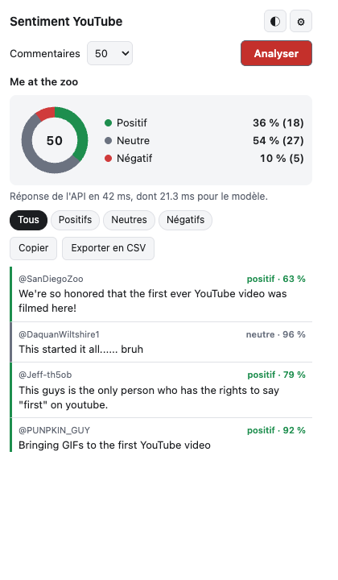
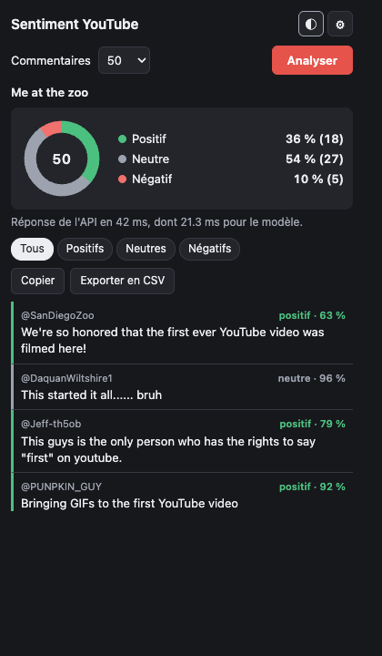
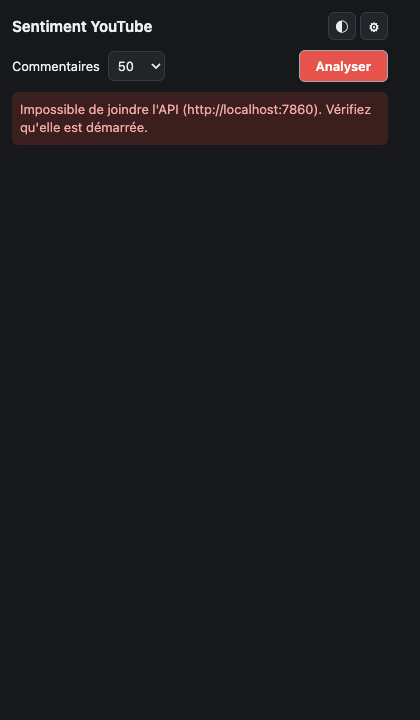

# Guide de l'extension Chrome

## Installation

1. Décompresser `chrome-extension.zip`, ou utiliser directement le dossier `chrome-extension/`.
2. Ouvrir `chrome://extensions`.
3. Activer le **mode développeur**, en haut à droite.
4. Cliquer sur **Charger l'extension non empaquetée** et choisir le dossier.
5. Épingler l'extension depuis l'icône en forme de pièce de puzzle.

## Utilisation

1. Ouvrir une vidéo YouTube.
2. Cliquer sur l'icône de l'extension.
3. Choisir le nombre de commentaires à analyser : 50, 100, 200 ou 500.
4. Cliquer sur **Analyser**. La page défile seule pour charger les commentaires, puis revient à sa position.

## Fonctionnalités

| Fonction | Utilisation |
|---|---|
| Statistiques | Graphique et pourcentages par sentiment |
| Liste | Auteur, sentiment et confiance de chaque commentaire ; les réponses sont marquées `↳` |
| Filtres | Tous, Positifs, Neutres, Négatifs |
| Mode sombre | Bouton `◐`, le choix est mémorisé |
| Copier | Copie le résumé et les commentaires du filtre actif |
| Exporter | Télécharge les commentaires du filtre actif en CSV |
| Choix de l'API | Bouton `⚙` : `http://localhost:7860` ou une URL `https://*.hf.space` |

## Problèmes fréquents

| Message | Solution |
|---|---|
| Ouvrez une vidéo YouTube | L'onglet actif n'est pas une vidéo |
| Aucun commentaire trouvé | Commentaires désactivés, ou page pas encore chargée : réessayer |
| Impossible de joindre l'API | Démarrer l'API locale ou vérifier l'URL dans `⚙` |
| L'API ne répond pas après 60 s | Le Space était peut-être en veille : réessayer |

