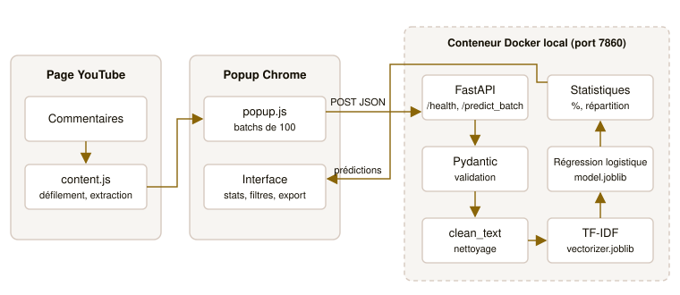
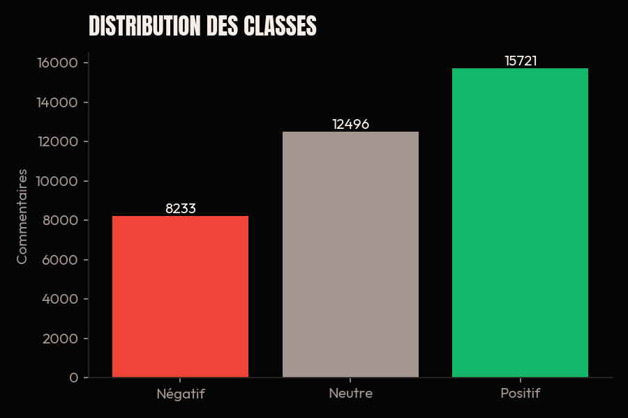
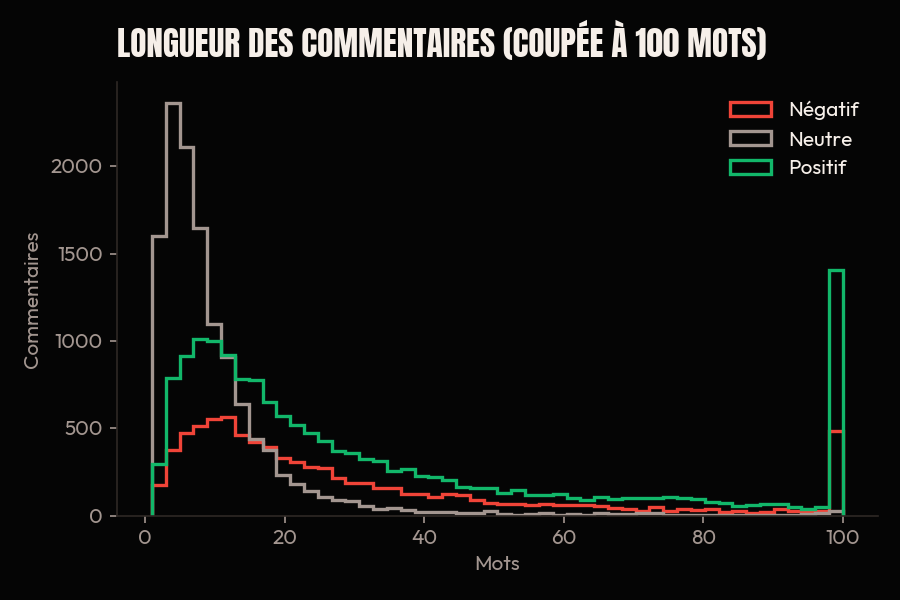
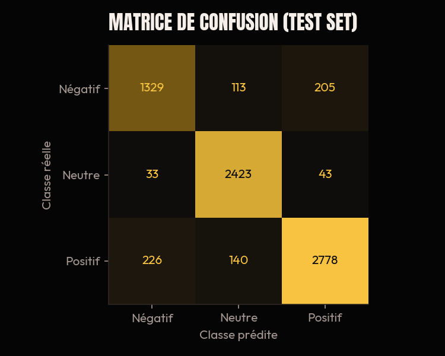
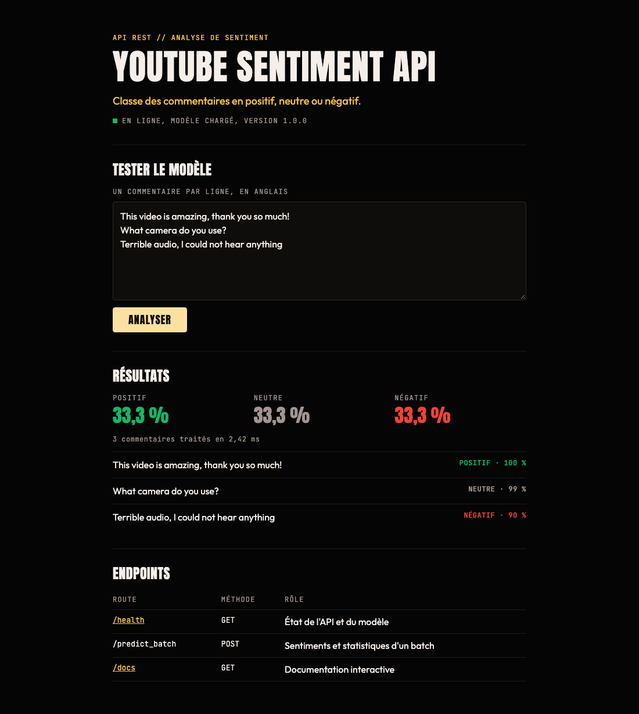
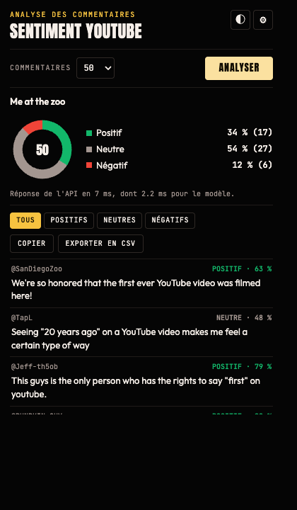
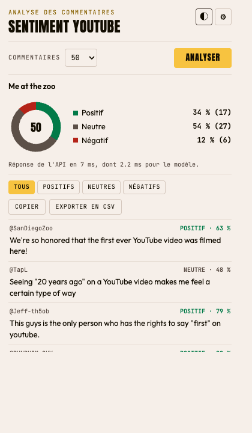

# Rapport technique : analyse de sentiment des commentaires YouTube

**Auteur :** Aymane ISSAMI. **Encadrante :** Prof. Maria Zemzami. **Filière :** INDIA, 2026/27.

## 1. Problème et solution proposée

Les créateurs reçoivent trop de commentaires pour les lire tous. L'analyse manuelle est lente, subjective et difficile à chiffrer.

La solution est une extension Chrome qui analyse les commentaires d'une vidéo depuis la page elle-même, grâce à une API de classification conteneurisée. Chaque commentaire est classé positif, neutre ou négatif, et l'utilisateur obtient une répartition globale.

## 2. Architecture



Le système suit les six étapes du flux de données demandé :

1. L'utilisateur ouvre une vidéo YouTube et lance l'analyse depuis le popup.
2. Le content script fait défiler la page, puis extrait les commentaires visibles.
3. Le popup envoie les commentaires à l'API par batchs de 100.
4. L'API valide la requête, nettoie les textes, les vectorise et les classe.
5. L'API renvoie les prédictions, les statistiques et le temps de traitement.
6. Le popup affiche la répartition et la liste des commentaires.

Le nettoyage (`src/data/preprocessing.py`) est le même à l'entraînement et en production, pour éviter tout écart entre les deux.

## 3. Données

Dataset Reddit fourni : 37 249 lignes, dont 100 textes manquants. Après nettoyage et dédoublonnage, il reste **36 450 commentaires** : 15 721 positifs, 12 496 neutres et 8 233 négatifs, soit un ratio de 1,9 entre la classe la plus grande et la plus petite.



Les commentaires neutres sont nettement plus courts (médiane de 7 mots, contre 20 et 21 pour les autres).



Choix effectués :

- **Dédoublonnage avant le split**, pour qu'un même texte ne se retrouve pas en train et en test.
- **Split 80/20 stratifié**, avec une graine fixe : 29 160 commentaires en train, 7 290 en test.
- **Déséquilibre traité par `class_weight="balanced"`**, sans suréchantillonnage.

## 4. Modèle

### Comparaison (validation croisée à 3 plis, sur le train, sans optimisation)

| Algorithme | Accuracy | F1 macro |
|---|---|---|
| SVM linéaire | 86,3 % | 0,849 |
| Régression logistique | 82,7 % | 0,816 |
| Random Forest | 68,0 % | 0,626 |
| Naive Bayes | 54,4 % | 0,416 |

Le SVM est le meilleur sans optimisation. La régression logistique a été retenue, car l'architecture du TP l'impose et parce qu'elle fournit des probabilités directement, utiles pour afficher une confiance. Après optimisation, son F1 macro (0,868) dépasse celui du SVM non optimisé ; le SVM n'a toutefois pas été optimisé, cette comparaison n'est donc pas à armes égales.

### Optimisation (GridSearchCV, F1 macro)

| Paramètre | Valeurs testées | Retenu |
|---|---|---|
| `C` | 1, 3, 10, 30, 100 | 30 |
| `ngram_range` | (1,1), (1,2) | (1,1) |
| `max_features` | 20 000, 50 000 | 20 000 |
| `sublinear_tf` | oui, non | oui |

Les stop words sont conservés, car la liste anglaise standard retire `not` et `no`.

### Résultats sur le test set

| Classe | Précision | Rappel | F1 |
|---|---|---|---|
| Négatif | 0,837 | 0,807 | 0,822 |
| Neutre | 0,906 | 0,970 | 0,936 |
| Positif | 0,918 | 0,884 | 0,900 |

**Accuracy : 89,6 %. F1 macro : 0,886. Inférence sur 50 commentaires : 0,95 ms en moyenne, 1,3 ms au p95.** Tous les critères du TP sont atteints.



## 5. API REST

L'application est découpée en trois modules : `schemas.py` pour les contrats Pydantic, `predictor.py` pour le modèle et `main.py` pour les routes. Le fichier `app_api.py` sert de point d'entrée au serveur.

| Endpoint | Méthode | Rôle |
|---|---|---|
| `/health` | GET | État de l'API et du modèle ; 503 si le modèle n'est pas chargé |
| `/predict_batch` | POST | Prédictions et statistiques pour 1 à 500 commentaires |
| `/` | GET | Page d'accueil : état de l'API et test du modèle |
| `/docs` | GET | Documentation interactive |

Exemple de requête et de réponse (résumée) :

```bash
curl -X POST http://localhost:7860/predict_batch \
  -H "Content-Type: application/json" \
  -d '{"comments": ["This video is amazing!"]}'
```

```json
{
  "predictions": [
    {"text": "This video is amazing!", "label": 1,
     "sentiment": "positif", "confidence": 0.9992}
  ],
  "statistics": {"total": 1, "counts": {"negatif": 0, "neutre": 0, "positif": 1}},
  "processing_time_ms": 1.9
}
```

Le modèle est chargé une seule fois au démarrage. Un batch vide, un mauvais type ou un JSON mal formé renvoie 422, et une erreur imprévue renvoie 500 sans exposer de détail interne. Un texte vide après nettoyage (emoji inconnu, alphabet non latin) est renvoyé en neutre avec une confiance de 0, pour ne pas présenter un résultat arbitraire comme une prédiction.



## 6. Extension Chrome

L'extension utilise le Manifest V3 et demande les seules permissions utiles : `activeTab`, `scripting`, `storage`, et l'accès à YouTube et à l'API.

YouTube ne charge les commentaires qu'au défilement. Le content script fait donc défiler la page jusqu'au nombre demandé, s'arrête après environ 5 secondes sans nouveau commentaire, puis rend à l'utilisateur sa position. Les réponses déjà visibles sont gardées et marquées `↳`, et les doublons sont retirés.

| Thème sombre | Thème clair |
|---|---|
|  |  |

Toutes les fonctionnalités demandées sont présentes : statistiques, liste avec confiance, filtres, thème clair et sombre, copie, plus un export CSV. Les erreurs sont expliquées à l'utilisateur : page qui n'est pas une vidéo, commentaires absents, API injoignable ou délai dépassé.

## 7. Exécution et déploiement

**Écart avec le sujet.** Le TP demande un déploiement sur Hugging Face Spaces. La création du Space a été refusée avec une erreur `402 Payment Required` : sur ce compte, un Space Docker exige un abonnement PRO. L'API s'exécute donc en local, sur le port 7860, avec Uvicorn ou dans le conteneur Docker.

Le `Dockerfile` applique les bonnes pratiques demandées :

- image de base légère `python:3.10-slim` ;
- dépendances copiées et installées avant le code, pour profiter du cache des couches ;
- copie des seuls fichiers de production, renforcée par un `.dockerignore` ;
- port 7860 exposé, utilisateur non root et `HEALTHCHECK` sur `/health`.

Le déploiement reste prêt : `scripts/deploy_hf.sh` crée le Space, y envoie les fichiers de production et met à jour l'URL de l'extension. Ce script n'a pas pu aller au bout à cause du refus de Hugging Face, il n'est donc pas validé en conditions réelles.

## 8. Choix techniques

| Choix | Justification |
|---|---|
| FastAPI | Validation et documentation intégrées |
| Modèle chargé au démarrage | Pas de coût de chargement à chaque requête |
| CORS limité à `chrome-extension://` | Les sites web ne peuvent pas appeler l'API depuis un navigateur |
| Manifest V3 | Version actuelle exigée par Chrome |
| `textContent` dans le popup | Un commentaire ne peut pas injecter de HTML |
| Protection des cellules CSV | Un commentaire commençant par `=` ne s'exécute pas dans un tableur |
| Image `python:3.10-slim`, utilisateur non root | Image légère, moins de droits |
| Polices embarquées dans l'extension | Aucune requête vers un service externe pour l'affichage |

## 9. Tests

| Niveau | Contenu | Résultat |
|---|---|---|
| Unitaires et API (`pytest`) | Nettoyage, critères du modèle, cas limites, batchs de 1 à 500, erreurs, CORS, pages et fichiers statiques | 53 réussis, 1 échec attendu (négation) |
| Conteneur | Build, `/health` et `/predict_batch`, utilisateur non root, système de fichiers en lecture seule | Réussi, image de 572 Mo |
| Extension (`tests/e2e_extension.py`) | Chromium, vraie vidéo YouTube, API dans le conteneur Docker local : extraction de 50 commentaires, filtres, thèmes, copie, CSV, erreur réseau | Réussi, réponse de l'API en 36 ms |
| Intégration avec une API cloud | Extension → Hugging Face → résultats | **Non réalisé** : déploiement refusé (erreur 402) |

## 10. Limites

- **Écart Reddit/YouTube.** Le modèle a été entraîné sur des commentaires Reddit, souvent politiques. Les 89,6 % ne mesurent pas la performance sur YouTube. Sur 25 commentaires de style YouTube écrits à la main, 21 sont bien classés ; c'est un simple contrôle sur un petit échantillon, pas une mesure fiable.
- **Négation.** « This is not good at all » est classé positif et « Not helpful » neutre. Ce cas figure dans les tests comme échec attendu.
- **Confiance trop élevée.** Le modèle a affiché 100 % sur des erreurs. Avec `C = 30`, les probabilités sont peu régularisées, la confiance doit donc se lire comme un indice, pas comme une probabilité fiable.
- **Qualité des labels.** Plusieurs exemples semblent discutables (« what bunch fools » est labellisé positif). Une partie du score peut venir de l'apprentissage de la méthode de labellisation plutôt que du sentiment réel.
- **Langue.** Seul l'anglais est appris. Un texte en alphabet non latin est renvoyé en neutre avec une confiance nulle, et le français est classé sans vocabulaire adapté.
- **Pas de déploiement cloud.** L'API n'est accessible que depuis la machine qui l'exécute, et le temps de réponse mesuré est celui d'un appel local, sans latence réseau.
- **Dépendance à YouTube.** L'extraction repose sur les sélecteurs de la page, qui peuvent changer.

## 11. Difficultés rencontrées

Difficultés constatées pendant le développement :

- **Déploiement refusé.** Hugging Face a répondu par une erreur 402 à la création du Space Docker. Le projet a été recentré sur une exécution locale, avec une image Docker et un script de déploiement prêts.
- **Démarrage lent de l'API.** L'import de scikit-learn prend plusieurs secondes, et un premier test échouait car il interrogeait l'API trop tôt. D'où le `start-period` du `HEALTHCHECK`.
- **Python système trop récent.** La machine utilisait Python 3.15 ; le projet utilise un environnement 3.10 pour correspondre à l'image Docker et garantir la compatibilité du modèle.
- **Dataset sans emojis.** Il a fallu ajouter une table de traduction pour ne pas perdre cette information sur YouTube.
- **Valeur de `C` en limite de grille.** Le premier résultat (`C = 30`) était la valeur maximale testée. La grille a été élargie à 100 pour confirmer ce choix.

**À COMPLÉTER :** tes propres difficultés.

## 12. Améliorations possibles

1. Déployer l'API sur un hébergeur cloud.
2. Annoter un échantillon de vrais commentaires YouTube pour mesurer la performance réelle et réentraîner.
3. Traiter la négation, ou passer à un modèle de type DistilBERT.
4. Calibrer les probabilités avec `CalibratedClassifierCV`, et comparer le SVM optimisé à la régression logistique.
5. Ajouter un modèle multilingue, le français et l'arabe étant absents.
6. Ajouter une CI GitHub Actions et suivre la distribution des prédictions pour détecter une dérive.
